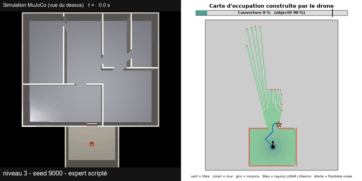
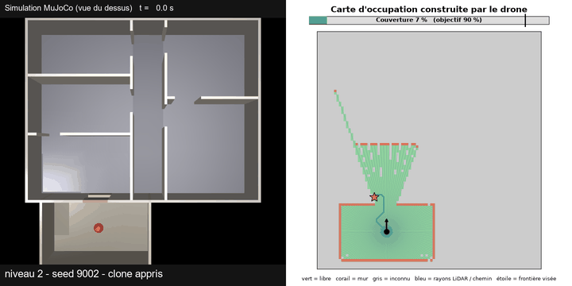
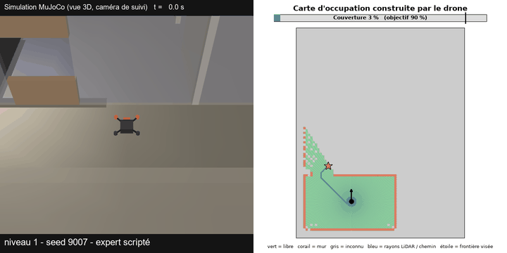
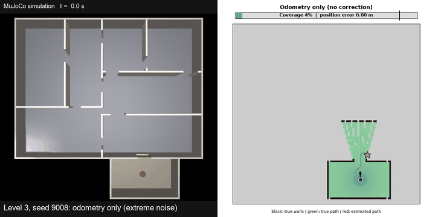
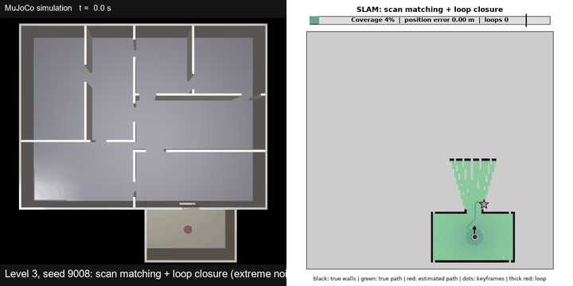

# Scanner

A simulated drone enters an unknown house through a window and maps it live with a 2D LiDAR, with no prior plan of the building. A classical planner decides where to go, a neural policy flies there, and a tuned PID cascade keeps the drone stable.

<p align="center">
  
</p>

*Level 3 house (loops, several doors): 98% of the map in 21 s. Left: the simulation. Right: the occupancy map built live, with LiDAR rays, the target frontier (star) and the BFS path (blue).*

## Results

Success rate on unseen houses (success = 90% of the reachable area mapped, no crash):

| | Level 1 | Level 2 | Level 3 | Level 4 |
|---|---|---|---|---|
| Scripted explorer (BFS planner) | 100% | 100% | 95% | 85% |
| Neural policy (imitation of the explorer) | 100% | 93% | 60% | 53% |

Level 1 is a small house (3-4 rooms), level 4 a large one (8-10 rooms, loops, doors of 1.0-1.3 m).

- **Hybrid architecture:** BFS toward the nearest unexplored area, a neural policy that follows it, a velocity-to-attitude PID cascade at the bottom.
- **Flight control:** attitude loop rise time cut from 414 ms to 76 ms. A seed that failed with every earlier configuration went from 7% to 87%.
- **Smooth commands:** a smoothness regulariser (CAPS) makes commands 4x smoother and reaches 100% success on the chain buildings.
- **Procedural houses:** 4 difficulty levels, 1,200 generated plans checked for physical accessibility by a drone of real size.
- **Negative result, measured:** pure end-to-end RL reaches at best 27% on level 1 houses (see [Research finding](#research-finding-pure-rl-on-houses)).
- **SLAM:** the exact pose is replaced by an estimate (noisy odometry + scan matching + loop closure, no learning): position error 0.1-0.3 m and success within the noise of the exact-pose results (see [Pose estimation](#pose-estimation-2d-lidar-slam)).

## More demos

<p align="center">
  
</p>

*Level 2, neural policy trained by imitation: 98.5% in 13 s.*

<p align="center">
  
</p>

*Level 1, 3D follow camera (walls drawn translucent, the orange side is the drone's front): 100% in 7 s.*

All gifs are sped up and run on seeds the controllers never saw.

## How it works

```
2D LiDAR (180 rays) -> occupancy grid (15 cm) -> frontiers + BFS path
                                                       |
                         neural policy or script  <----+
                                  |
                       velocity setpoint (max 6 m/s)
                                  |
              PID cascade: velocity -> attitude -> angular rate
                                  |
                       motor torques -> MuJoCo
```

- **Environment:** a new house every episode. The only entrance is a window in the south wall, reached from a closed courtyard.
- **Frontiers and planning:** a frontier is a free cell next to unknown space. A BFS over known free cells, kept 0.45 m from walls, gives the path distance and the first step toward the nearest frontiers.
- **Controller:** fixed altitude of 1.2 m, attitude limited to 35 degrees. The nose follows the direction of motion (display only, the network works in the world frame).
- **Policy network:** MLP on 16 distance sectors, the BFS frontier vector and velocity, plus a CNN on a 3 x 64 x 64 local map crop. Trained by imitation of the script, or by PPO + CAPS for the pure RL runs.

## Research finding: pure RL on houses

The initial goal was to learn exploration end to end with RL. It works on simple chain buildings (100%), but not on realistic houses: 27% at best on level 1, across seven variants (BFS compass, progress reward, stagnation penalty, coarser map, other discount factor). One seed and 30 houses give about +-8 points, so these variants are statistically indistinguishable. What changes is how they fail: crashing into walls, or standing almost still (95% of the steps without discovering a cell).

The straight-line direction to the nearest frontier crosses a wall in 80-99% of the steps, but replacing it with a BFS path did not fix the success rate. No cause is isolated. Exploration noise inside doors with +-0.5 m clearance is the most likely one.

Full tables, version history and measurements (in French): [docs/experiments.md](docs/experiments.md).

## Pose estimation: 2D LiDAR SLAM

Everything above uses the exact pose given by the simulator. This part removes it. The drone only gets noisy velocity and yaw-rate measurements, like an odometer and a gyro, and has to build its map and localise itself from the LiDAR. No machine learning, no training.

<p align="center">
  
</p>

*Odometry only (extreme noise): the errors add up, the map is smeared (ghost walls), the planner is misled and the drone crashes.*

<p align="center">
  
</p>

*Same house, same noise, with SLAM: the estimated path (red) follows the true one (green), the map stays on the true walls (black), and loop closures (thick red) rebuild the map.*

- **Odometry:** speed and yaw rate with a scale error, a constant bias and white noise (levels low / medium / high / extreme, chosen by hand, not calibrated on a real sensor). The estimate drifts.
- **Scan matching:** each LiDAR scan is aligned on the map built so far by testing small corrections of x, y and heading and keeping the one where the scan points fall best on the known walls.
- **Loop closure:** keyframes (pose + scan) are stored every 0.5 m. When the drone comes back near an old keyframe, the scan is checked against a local map of the old keyframes. A pose graph is then optimised (Gauss-Newton) and the map is rebuilt from the corrected keyframes.

Scripted explorer, 20 houses per cell (about +-10 points), same houses and seeds as the exact-pose results:

| Success | Level 1 | Level 2 | Level 3 | Level 4 |
|---|---|---|---|---|
| Exact pose | 100% | 100% | 95% | 85% |
| Odometry only, high noise | 95% | 50% | 55% | 45% |
| Scan matching, high noise | 100% | 100% | 90% | 80% |
| Scan matching + loop closure, high noise | 100% | 100% | 85% | 90% |

| Extreme noise | Level 2 | Level 3 | Level 4 |
|---|---|---|---|
| Position error, odometry only | 7.3 m | 8.0 m | 7.6 m |
| Position error, scan matching | 0.13 m | 0.48 m | 0.57 m |
| Position error, + loop closure | 0.13 m | 0.20 m | 0.42 m |
| Success, odometry only / scan matching / + loop closure | 35 / 100 / 100% | 20 / 80 / 90% | 15 / 80 / 80% |

- Scan matching does most of the work. Loop closure changes little at low to high noise (error at closure 0.134 m before, 0.128 m after) and helps at extreme noise.
- 499 loops accepted over 240 flights, none false (checked against the true pose). At extreme noise, 189 loops and 1 false.
- Cost on a desktop CPU, unoptimised Python: about 6 ms per scan for matching and 8 ms per keyframe for the back end.

## Limits

- The neural policy imitates the script and receives its BFS direction as an input: it does not discover where to go by itself.
- Exact pose from the simulator in every experiment except the SLAM one, which uses the scripted explorer only.
- SLAM: the simulated LiDAR has no measurement noise, the start pose is known, the odometry noise is hand-picked, the PID flies with the true state (like an IMU would), and these small houses give few chances to close a loop (98 of 240 flights contain at least one).
- 2D LiDAR at a fixed altitude, one floor.
- Most RL runs use a single seed, with 30 evaluation houses (the expert is measured on 20 per level).
- Mean tilt is still high (about 30 degrees).

## Reproduce

```
pip install -r requirements_runner.txt imageio imageio-ffmpeg

# SLAM measurements (levels 1-4, 20 houses) and demo
python src/pose_eval.py --levels 1 2 3 4 --noise low medium high --pose-source slam_lc
python src/make_demo.py --pose-source slam_lc --odom-noise extreme --level 3 --seeds 9008 --stride 8 --gif --out demo

# demo gifs
python src/make_demo.py --level 2 --seeds 9002 --stride 4 --gif --out demo
python src/make_demo.py --policy clone --model bc2_s42 --level 2 --seeds 9002 --stride 4 --gif --out demo

# imitation of the scripted explorer, then evaluation
python src/imitate.py --name bc2_s42 --samples 80000 --epochs 25
python src/evaluate.py --name bc2_s42 --n-episodes 30 --building house --house-level 3 --max-steps 3000
```

Run each script with `--help` for all options.

<details>
<summary>Project layout</summary>

| File | Purpose |
|---|---|
| `src/explorer_env.py` | Gymnasium environment (physics, LiDAR, reward, PID cascade) |
| `src/house_generator.py` | House generator, 4 levels, accessibility check |
| `src/building_generator.py` | First generator (chains of rooms) |
| `src/occupancy_grid.py` | Occupancy grid, frontier detection, BFS features |
| `src/expert.py` | Scripted explorer used as teacher |
| `src/imitate.py` | Imitation of the explorer by the policy network |
| `src/caps_ppo.py` | PPO with the CAPS smoothness regulariser |
| `src/train.py`, `src/evaluate.py` | Training and evaluation |
| `src/make_demo.py` | Split-screen demo videos |
| `src/pose_estimation.py` | Noisy odometry and scan matching |
| `src/slam_backend.py` | Keyframes, loop closure, pose graph, map rebuild |
| `src/pose_eval.py` | SLAM measurements (`docs/results/*.csv`) |

</details>

**Stack:** MuJoCo, Gymnasium, Stable-Baselines3, PyTorch, NumPy, matplotlib, imageio.